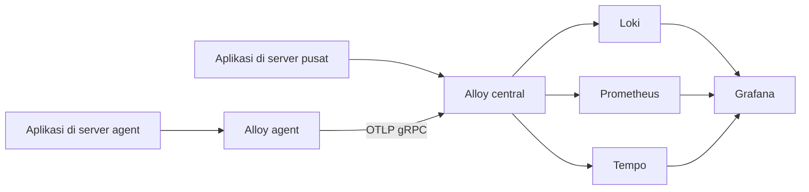

# Monitoring stack: OpenTelemetry, Alloy, Grafana

Alloy menerima telemetri OpenTelemetry dari aplikasi melalui OTLP gRPC atau HTTP. Pipeline mengirim logs ke Loki, metrics ke Prometheus Remote Write, dan traces ke Tempo.



## Arsitektur deployment

Deployment dibagi menjadi dua jenis server:

- **Server central** menjalankan infrastructure utama: Alloy central, Loki,
  Prometheus, Tempo, Grafana, serta service opsional PostgreSQL, RabbitMQ,
  Redis, dan MinIO.
- **Server agent** hanya menjalankan Alloy lokal. Aplikasi pada server agent
  mengirim telemetri ke Alloy lokal, lalu Alloy lokal meneruskan telemetri ke
  Alloy central menggunakan OTLP gRPC.

Loki tidak menerima data langsung dari Alloy agent. Alurnya adalah:

```text
Aplikasi agent -> Alloy agent -> Alloy central -> Loki
                                           -> Prometheus
                                           -> Tempo
```

Server agent tidak perlu bergabung ke Docker network `infra_network`. Agent
terhubung ke server central melalui alamat host dan port Alloy central.

## Setup server central

Server central menjalankan `docker-compose.central.yml` dan menjadi tempat
penyimpanan seluruh telemetri. Profile `observability` menjalankan Prometheus,
Loki, Tempo, Alloy central, dan Grafana.

### Menjalankan infrastructure lengkap

Untuk menjalankan seluruh profile pada server central:

```bash
docker compose \
  -f docker-compose.central.yml \
  --profile observability \
  --profile db \
  --profile messaging \
  --profile cache \
  --profile storage \
  up -d
```

Profile yang dijalankan:

| Profile | Service |
| --- | --- |
| `observability` | Prometheus, Loki, Tempo, Alloy, Grafana |
| `db` | PostgreSQL/PostGIS |
| `messaging` | RabbitMQ |
| `cache` | Redis |
| `storage` | MinIO |

Validasi service:

```bash
docker compose -f docker-compose.central.yml ps
docker compose -f docker-compose.central.yml config
```

Jika hanya membutuhkan observability, jalankan:

```bash
docker compose \
  -f docker-compose.central.yml \
  --profile observability \
  up -d
```

### Endpoint server central

| Service | Endpoint default | Kegunaan |
| --- | --- | --- |
| Grafana | `http://CENTRAL_IP:3000` | Dashboard dan Explore |
| Loki | `http://CENTRAL_IP:3100` | Query log |
| Tempo | `http://CENTRAL_IP:3200` | Query trace |
| Prometheus | `http://CENTRAL_IP:9090` | Query metric |
| Alloy OTLP gRPC | `CENTRAL_IP:4317` | Input telemetri |
| Alloy OTLP HTTP | `http://CENTRAL_IP:4318` | Input OTLP HTTP |

Pada aplikasi yang juga berjalan di Docker network `infra_network`, gunakan
nama service, bukan IP host:

```env
OTEL_EXPORTER_OTLP_ENDPOINT=http://alloy:4317
OTEL_EXPORTER_OTLP_PROTOCOL=grpc
```

Pada aplikasi yang berjalan langsung di server central:

```env
OTEL_EXPORTER_OTLP_ENDPOINT=http://127.0.0.1:4317
OTEL_EXPORTER_OTLP_PROTOCOL=grpc
```

### Firewall server central

Izinkan TCP `4317` dari alamat IP server agent. Port `4318` hanya perlu dibuka
jika client remote menggunakan OTLP HTTP. Port Grafana, Loki, Prometheus, dan
Tempo sebaiknya hanya dibuka untuk jaringan administrator atau melalui reverse
proxy dengan TLS.

Grafana menggunakan kredensial default dari `docker-compose.central.yml`:

```env
GF_SECURITY_ADMIN_USER=admin
GF_SECURITY_ADMIN_PASSWORD=admin123
```

Ganti nilai tersebut melalui environment variable sebelum deployment.

Tambahkan data source di Grafana:

- Loki: `http://loki:3100`
- Prometheus: `http://prometheus:9090`
- Tempo: `http://tempo:3200`

## Setup server agent

Server agent hanya menjalankan Alloy lokal. Aplikasi di server agent mengirim
telemetri ke Alloy lokal pada port `4317` atau `4318`. Alloy agent kemudian
meneruskan semua telemetry ke Alloy central melalui OTLP gRPC.

### Konfigurasi endpoint Alloy central

Pada server agent, buat file `.env` di direktori repository:

```env
OTEL_GATEWAY_ENDPOINT=CENTRAL_IP:4317
```

`CENTRAL_IP` harus berupa IP atau DNS server central yang dapat dijangkau dari
server agent. Nilai tersebut tidak menggunakan `http://` karena dipakai sebagai
endpoint OTLP gRPC oleh `alloy/agent.alloy`.

Tes konektivitas dari server agent:

```bash
nc -vz CENTRAL_IP 4317
```

### Menjalankan agent

Gunakan hanya compose agent:

```bash
docker compose \
  -f docker-compose.agent.yml \
  --profile agent \
  up -d

docker compose -f docker-compose.agent.yml ps
docker compose -f docker-compose.agent.yml logs -f alloy
```

Jangan menjalankan `docker-compose.central.yml` di server agent. Server agent
tidak perlu bergabung ke Docker network `infra_network`.

### Konfigurasi aplikasi pada server agent

Untuk aplikasi yang mendukung OTLP gRPC:

```env
OTEL_SERVICE_NAME=my-agent-app
OTEL_EXPORTER_OTLP_ENDPOINT=http://127.0.0.1:4317
OTEL_EXPORTER_OTLP_PROTOCOL=grpc
```

Untuk aplikasi yang menggunakan OTLP HTTP:

```env
OTEL_SERVICE_NAME=my-agent-app
OTEL_EXPORTER_OTLP_ENDPOINT=http://127.0.0.1:4318
OTEL_EXPORTER_OTLP_PROTOCOL=http/protobuf
```

Dengan konfigurasi tersebut, aplikasi tidak mengirim log langsung ke Loki.
Alurnya tetap:

```text
Aplikasi server agent
  -> Alloy agent :4317/:4318
  -> Alloy central :4317
  -> Loki / Prometheus / Tempo
```

Batasi port `4317`, `4318`, dan `12345` pada server agent agar hanya dapat
diakses dari localhost atau jaringan aplikasi. Compose agent saat ini
mempublikasikan port tersebut pada host, sehingga pembatasan firewall wajib
dilakukan jika aplikasi hanya berjalan lokal.

## Query telemetri dari server agent

Semua data dicari pada endpoint server central, bukan pada server agent.

Query log Loki:

```text
http://CENTRAL_IP:3100/loki/api/v1/query?query={service_name="my-agent-app"}
```

Metrics dapat dicari di:

```text
http://CENTRAL_IP:9090
```

Trace dapat dicari melalui Grafana Explore pada data source Tempo:

```text
http://CENTRAL_IP:3000
```

## Garage S3 single-node

Garage dijalankan sebagai layanan terpisah menggunakan `garage.yml` dan
`garage.toml`. Konfigurasi pada repository ini menggunakan satu node dengan
`replication_factor = 1`, sehingga cocok untuk development atau instalasi
tanpa redundansi. Untuk production multi-node, gunakan `replication_factor`
yang sama pada semua node dan konfigurasi jaringan antar-node yang berbeda.

### Prasyarat

- Docker Engine dan Docker Compose v2.
- Port `3900` tersedia untuk S3 API.
- Port `3901` hanya untuk komunikasi RPC Garage.
- Port `3903` hanya untuk Admin API; jangan expose ke internet tanpa
  autentikasi dan TLS.

### Konfigurasi awal

`garage.toml` harus memiliki `replication_factor` di level paling atas:

```toml
metadata_dir = "/var/lib/garage/meta"
data_dir = "/var/lib/garage/data"
db_engine = "sqlite"
replication_factor = 1

rpc_secret = "<64-karakter-hex-acak>"
rpc_bind_addr = "[::]:3901"
rpc_public_addr = "127.0.0.1:3901"

[s3_api]
api_bind_addr = "[::]:3900"
s3_region = "garageregion"
root_domain = ".s3.garage.localhost"

[admin]
api_bind_addr = "[::]:3903"
admin_token = "<token-admin-acak>"
```

Generate secret sebelum mengisi nilai tersebut:

```bash
openssl rand -hex 32       # rpc_secret
openssl rand -base64 32    # admin_token
```

Jangan gunakan nilai contoh, secret all-zero, atau commit secret production ke
repository. `rpc_public_addr = "127.0.0.1:3901"` hanya benar untuk single-node.
Pada cluster, setiap node harus menggunakan alamat RPC yang dapat dijangkau
oleh node lainnya.

### Menjalankan Garage

Dari root repository:

```bash
docker compose -f garage.yml up -d
docker compose -f garage.yml ps
docker logs -f garage-server
```

Pastikan log tidak lagi menampilkan `The option replication_factor is required`.

### Membuat layout single-node

Pada instalasi baru, node belum memiliki role dan layout. Ambil node ID:

```bash
docker exec garage-server /garage status
```

Jika output menunjukkan `NO ROLE ASSIGNED`, assign kapasitas dan apply layout:

```bash
docker exec garage-server /garage layout assign \
  -z dc1 \
  -c 1G \
  <NODE_ID>

docker exec garage-server /garage layout apply --version 1
```

Ganti `<NODE_ID>` dengan ID pada kolom pertama output `garage status`.
Perintah `layout apply --version 1` hanya untuk layout pertama. Untuk layout
yang sudah pernah diterapkan, gunakan nomor versi berikutnya sesuai output:

```bash
docker exec garage-server /garage layout show
```

### Membuat bucket dan access key S3

Buat bucket:

```bash
docker exec garage-server /garage bucket create monitoring-data
```

Buat access key. Simpan `Key ID` dan `Secret key` dari output karena secret
tersebut tidak boleh dibagikan:

```bash
docker exec garage-server /garage key create monitoring-client
```

Berikan hak baca, tulis, dan owner kepada key:

```bash
docker exec garage-server /garage bucket allow \
  --read \
  --write \
  --owner \
  monitoring-data \
  --key monitoring-client
```

Periksa konfigurasi bucket dan key:

```bash
docker exec garage-server /garage bucket info monitoring-data
docker exec garage-server /garage key info monitoring-client
```

### Endpoint S3 dan akses dengan CLI

S3 API tersedia di:

```text
http://127.0.0.1:3900
```

Jika diakses dari mesin lain, ganti `127.0.0.1` dengan IP atau DNS server
Garage dan pastikan firewall hanya mengizinkan client yang diperlukan.

Contoh menggunakan MinIO Client (`mc`):

```bash
mc alias set garage \
  http://127.0.0.1:3900 \
  <ACCESS_KEY_ID> \
  <SECRET_ACCESS_KEY> \
  --api S3v4

mc ls garage/
mc cp ./file.txt garage/monitoring-data/
```

Contoh menggunakan AWS CLI:

```bash
export AWS_ACCESS_KEY_ID="<ACCESS_KEY_ID>"
export AWS_SECRET_ACCESS_KEY="<SECRET_ACCESS_KEY>"
export AWS_DEFAULT_REGION="garageregion"

aws --endpoint-url http://127.0.0.1:3900 s3 ls
aws --endpoint-url http://127.0.0.1:3900 \
  s3 cp ./file.txt s3://monitoring-data/
```

### Akses dengan UI

Garage tidak menyediakan web console S3 bawaan. Gunakan aplikasi S3 seperti
Cyberduck:

| Field | Nilai |
| --- | --- |
| Protocol | Amazon S3 / Garage |
| Server | `127.0.0.1` atau IP server |
| Port | `3900` |
| Access Key ID | Nilai `Key ID` dari Garage |
| Secret Access Key | Nilai `Secret key` dari Garage |
| Region | `garageregion` |
| TLS/SSL | Nonaktif untuk konfigurasi HTTP saat ini |

Port `3903` adalah Admin API, bukan UI. Health check Admin API:

```bash
curl \
  -H "Authorization: Bearer <ADMIN_TOKEN>" \
  http://127.0.0.1:3903/health
```

### Troubleshooting Garage

**`The option replication_factor is required`**

Tambahkan `replication_factor = 1` di level paling atas `garage.toml`. Error
ini umum muncul setelah upgrade image Garage dari versi lama ke `v2.4.1`.

**`NO ROLE ASSIGNED`**

Jalankan `garage layout assign` lalu `garage layout apply` seperti pada bagian
layout single-node.

**S3 `InvalidAccessKeyId` atau `AccessDenied`**

Pastikan menggunakan `Key ID` dan `Secret key` hasil dari `garage key create`,
bukan `admin_token`. Pastikan key juga sudah diberi akses ke bucket dengan
`garage bucket allow`.
